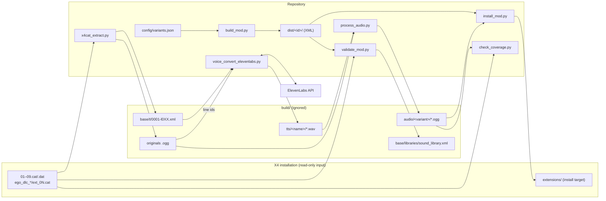

# 1 · The Big Picture

> **What you'll be able to answer after this chapter:** the major components and their boundaries (architecture), the direction of data and dependencies, the load-bearing design decisions and what they trade off (rationale), and how one build flows at a high level.

## Architecture

The project is a **linear, file-based pipeline** of independent command-line tools. There is no server, no database, no long-running process. Each tool reads files and writes files; the hand-off between steps is a folder on disk. A single JSON file declares what should be built.

### Components and boundaries

| Component | Owns | Does not own |
|---|---|---|
| `x4cat_extract.py` ([ch. 3](03-game-archives-and-extraction.md)) | Reading the game's `.cat/.dat` archives | Deciding what to extract (callers pass patterns) |
| `config/variants.json` ([ch. 4](04-variants-configuration.md)) | Which sound ids are patched, which variants exist, ids, texts, attribute patches, recipes | How audio is produced (recipes are documentation strings, not executed) |
| `process_audio.py` ([ch. 6](06-audio-processing.md)) | ffmpeg filter chains, loudness normalisation, gain | Where files come from or go to (paths are arguments) |
| `voice_convert_elevenlabs.py` ([ch. 7](07-text-to-speech.md)) | ElevenLabs calls, mapping game texts to line ids | Post-processing, loudness |
| `build_mod.py` ([ch. 5](05-building-and-validating.md)) | Generating `content.xml` and the `sound_library.xml` diff | Audio |
| `validate_mod.py` ([ch. 5](05-building-and-validating.md)) | Simulating the diff on the real game file | The game's own diff semantics (it re-implements a subset) |
| `install_mod.py` ([ch. 8](08-installing-and-releasing.md)) | Copying exactly one variant (XML + audio) into the game | Building, packaging for Workshop/ModDB |
| `check_coverage.py` ([ch. 9](09-patch-maintenance.md)) | Comparing game line ids with a variant's audio folder | Fixing gaps |
| `release/` ([ch. 8](08-installing-and-releasing.md)) | Manifest and texts for the external `modpub` tool | The tool itself (separate repository) |

### Direction of dependencies

Code dependencies are shallow and point "down" to two shared helpers:

- `validate_mod.py` and `check_coverage.py` import `x4cat_extract` (`tools/validate_mod.py:25`, `tools/check_coverage.py:22`).
- `voice_convert_elevenlabs.py` imports `find_ffmpeg` from `process_audio` (`tools/voice_convert_elevenlabs.py:30`).
- `build_mod.py`, `install_mod.py` read `config/variants.json` directly (`tools/build_mod.py:22`, `tools/install_mod.py:31`).

No tool calls another tool as a subprocess. Orchestration is done by the human (or an agent) following the recipe in the configuration.

## Load-bearing decisions

1. **Patch the index, never the game's audio.** Redirecting `<sample start>` to the mod's folder was proven to work in the game (diagnostic v6, `docs/HISTORY.md`). Replacing the game's own voice files was never attempted: the original research handoff (removed from the tree, see git history at `152a8db`) reported from a third-party project that an extension shipping files under the original voice path is ignored for audio. That report was not re-verified here (inference). Trade-off: one mod per voice language, and every line id the game knows must exist in the mod folder, because a missing file plays as silence ([ch. 13](13-failure-modes.md)).
2. **One JSON file drives everything.** `dist/` is generated and committed only so changes are reviewable; hand edits there are overwritten (`tools/build_mod.py:69-71`). Trade-off: the audio recipe is prose in the JSON, not executable, so a recipe can drift from what was actually run (inference: chosen because the steps involve paid API calls and human listening decisions that should not run implicitly).
3. **Validate offline against the real file.** The game reports a failed diff selector only in its log and then silently ignores the patch. `validate_mod.py` extracts the actual `sound_library.xml` and replays the diff, so mistakes surface before anyone starts the game. Trade-off: it re-implements only the diff features the project uses ([ch. 5](05-building-and-validating.md)).
4. **Audio stays out of git.** The audio is either Egosoft's processed recordings or generated from Egosoft's texts; neither should be published as source. Consequence: a fresh clone cannot be installed without regenerating audio.
5. **Two production methods for two languages.** Filtering kept the original German actor's regional colouring no matter how hard it was pushed; text-to-speech removed it. The English original needed only half-strength filtering. Decided by listening, documented in `docs/HISTORY.md`.

## How one build flows (high level)

Extract the originals and texts from the game → produce audio into `build/audio/<variant>/` (filter chain, or TTS then filter chain) → generate `dist/<id>/` from the configuration → replay the diff on the real `sound_library.xml` → copy `dist/<id>/` plus the audio into `<game>/extensions/<id>/` → start X4, which applies the diff and loads Boso Ta's lines from the mod folder. [Key Flows](11-key-flows.md) zooms into each step with real values.

## Where to look

`config/variants.json`, `tools/build_mod.py`, `docs/phase0-findings.md`, `docs/HISTORY.md`.

## Open questions

- The external `modpub` tool that consumes `release/mod.yaml` lives in another repository (`docs/RELEASE.md`, last section); its behaviour is not covered by this book.

→ Check your understanding: [quizzes/01-the-big-picture-quiz.md](quizzes/01-the-big-picture-quiz.md)
