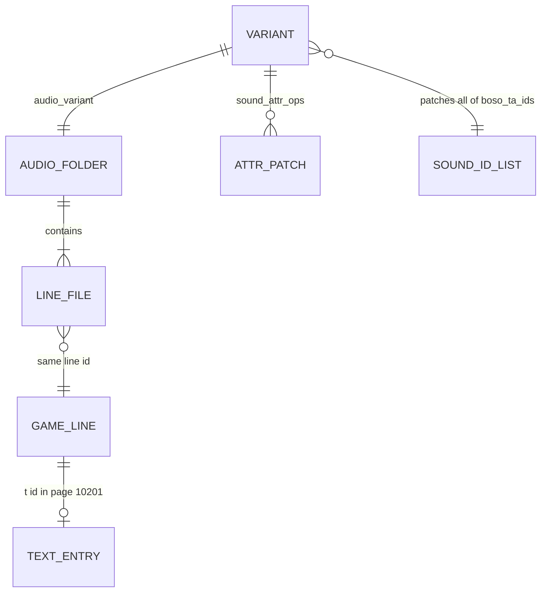

# 2 · Core Concepts & Domain Model

> **What you'll be able to answer after this chapter:** the vocabulary of X4's voice system as this codebase uses it (domain), what a "variant" is (domain/state), and which facts about the game are verified versus assumed.

All game facts below were verified against X4 9.00 on 2026-10-22; the evidence is collected in `docs/phase0-findings.md`.

## The game side

| Concept | Meaning here | Example |
|---|---|---|
| **Catalog** | A pair `NN.cat` (text index) + `NN.dat` (concatenated file data). The base game mounts `01`–`09`; DLCs have `extensions/ego_dlc_*/ext_0N.cat`. Later catalogs override earlier ones. | `08.cat` holds `libraries/sound_library.xml` |
| **Voice language** | A numeric code in the folder name. Only two tracks exist in the game data. | `voice-l044` = English, `voice-l049` = German |
| **Voice page** | The numeric id of a speaker's voice set. | `10201` = "Boron NPC 1 / Boron rep / Misc Plot Characters" = Boso Ta |
| **Context** | How a line is played: in person, over comms, broadcast. Each context has its own copy of every line. | `normal`, `comm`, `comm_npc`, `comm_broadcast` |
| **Line id** | The file name of one recorded line; equals the text id in the page of the text file. | `30201131` → "There are actually multiple ships involved…" |
| **Sound entry** | An element `<sound id="…">` in `sound_library.xml`, named `<page>_<context>`, with a `<sample start="…"/>` that names the folder to read. | `10201_normal` → `voice\10201\normal` |
| **Text file** | `t/0001-l0XX.xml`, one per language; page `10201` holds every Boso Ta line under its line id, including stage directions in parentheses. | `<t id="30201131">(…)There are actually…</t>` |
| **Extension** | A mod folder under `<game>/extensions/<id>/` with a `content.xml`. | `extensions/bosota_voice_will_de/` |
| **Diff** | An XML file whose root is `<diff>`; X4 applies its `<add>`, `<replace>`, `<remove>` operations to the game file of the same path. | `libraries/sound_library.xml` inside the mod |
| **Modified** | The state the game enters when it loads any unsigned file. Sticky on the save; no online Ventures (switched off by Egosoft anyway). Steam achievements still unlock according to player reports (unverified). | every mod, including this one |

### Boso Ta's six sound entries

Declared in `config/variants.json:10-17`:

| Sound id | In the base game reads | Used for |
|---|---|---|
| `10201_normal` | `voice\10201\normal` | talking to him in person |
| `10201_normal_npc` | `voice\10201\normal` | him talking to other NPCs nearby (quieter) |
| `10201_comm` | `voice\10201\comm` | comm window with the player |
| `10201_comm_signalleak` | `voice\10201\comm` | signal leaks (already has `noocclusion="true"` in the base game) |
| `10201_comm_npc` | `voice\10201\comm_npc` | NPC-to-NPC comms |
| `10201_comm_broadcast` | `voice\10201\comm_broadcast` | described in the base file as "secretive comms" |

After the mod, **all six read the same folder** `extensions\<id>\voice\10201\normal` (`tools/build_mod.py:29-35`). The original radio filtering of the comm recordings is therefore lost (accepted trade-off; see [Failure Modes](13-failure-modes.md)).

### Who speaks with page 10201

Boso Ta at the HQ (`md/x4ep1_mentor_subscription.xml`, two places), his clone on the Boron queen ship (`md/story_boron.xml`, Kingdom End), Boso Ta as narrator of a hidden demo scenario (`md/scenario_advanced.xml`), and the **Boron faction representative** (`factionrepresentative_boron` in the Boron DLC's `libraries/characters.xml`); `docs/phase0-findings.md` records the first and the last. All other Boron characters have their own pages and are unaffected: in `md/story_boron.xml` of the Boron DLC, Nila is created with page 10251, the Outer and Inner Bubble leaders with 10252 and 10253, and the generic Boron NPCs use 10202–10205 (game files, checked 2026-10-24; not recorded in the repository's docs). The page is assigned per actor in the mission scripts and stored in the save file.

### Line counts (context `normal`)

| | German `l049` | English `l044` |
|---|---|---|
| Line ids | 2,324 | 1,750 |
| With text in page 10201 | 2,319 | 1,750 |

The 574 German-only ids are pilot and crew phrases (`10001…`), alternate takes with an `fp` suffix (`30201430fp`) and a few plot lines that the English version gives to another speaker. Five German ids have no text at all: `10417`, `10603`, `30226001`–`30226003` (`config/variants.json:130`).

## The project side

| Concept | Meaning |
|---|---|
| **Variant** | One buildable mod: a key in `config/variants.json`, an extension `id`, an `audio_variant` folder name, bilingual name/description, attribute patches, a recipe. See [ch. 4](04-variants-configuration.md). |
| **Audio variant** | The folder name under `build/audio/` that holds a variant's processed `.ogg` files, e.g. `will_dark_g6`. By convention `<chain>_g<gain dB>`. |
| **Filter chain** | A named ffmpeg `-af` expression in `tools/process_audio.py:51-59`: `d12_alien_mid`, `alien_mid_50`, `will_dark`. |
| **Redirect** | Replacing `<sample start>` of a sound entry so the engine reads the mod's folder. |
| **Attribute patch** | `noocclusion="true"` (no muffling by geometry) and `is3d="0"` (no positional audio) added or replaced on sound entries. |
| **Workshop build** | A variant whose `id` is the Steam Workshop folder name `ws_<item number>`; required because Steam installs items under that name. |
| **Coverage** | Whether every line id the game has for page 10201 exists in a variant's audio folder. |

## Where to look

`docs/phase0-findings.md` (all evidence), `config/variants.json`, `docs/HOW-IT-WORKS.md` (non-technical version).

## Open questions

- What exactly `start`/`end`/`steps` of `<pitch>` do is undocumented by Egosoft; it is irrelevant now that no variant uses engine effects.

→ Check your understanding: [quizzes/02-core-concepts-quiz.md](quizzes/02-core-concepts-quiz.md)
