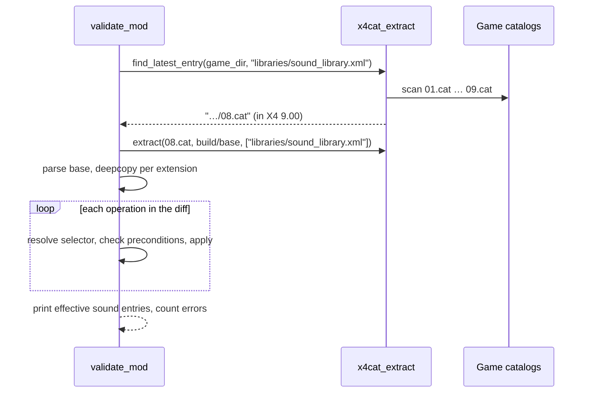

# 5 · Building & Validating (`tools/build_mod.py`, `tools/validate_mod.py`)

> **What you'll be able to answer after this chapter:** exactly what XML the generator writes and why each line is there (section "build_diff mechanism"), how the validator simulates X4's diff engine and which mistakes it catches or misses (sections "Mechanism" and "What it catches and what it misses"), and how to run both (section "Operations").

## Why two tools

X4 applies a mod's `libraries/sound_library.xml` diff to its own file at start-up. A diff is a list of change commands (`add`, `replace`, `remove`), each addressing a node of the original file with an XPath selector. If a selector matches nothing, the game writes "No matching node" into its log and skips that operation (verified in phase 0, `docs/phase0-findings.md:45`; the project reads the log by starting X4 with `-logfile debuglog.txt`, see `README.md`, "Troubleshooting"); the mod looks installed but does nothing. `build_mod.py` produces the diff deterministically from the configuration; `validate_mod.py` replays it against the **real** base file before anyone starts the game.

## `build_mod.py`

### Public surface

`python -I tools/build_mod.py [--only <variant key>]` (`-I` is Python's isolated mode; `tools/build_mod.py:60-63`). Its input is `config/variants.json` ([ch. 4](04-variants-configuration.md)): a *variant key* is a name under `variants` such as `alien_en`, `<id>` is that variant's `id` (folder name and extension id), and `<audio_variant>` names the folder of its processed audio. For every variant (or one), it writes:

- `dist/<id>/content.xml` (`build_content`, `:49-57`)
- `dist/<id>/libraries/sound_library.xml` (`build_diff`, `:26-46`)

and prints how many `.ogg` files exist in `build/audio/<audio_variant>/`, warning when there are none (`:72-75`). It does not create, convert or copy audio files.

### `build_diff` mechanism

```python
target = f"extensions\\{v['id']}\\voice\\10201\\normal"          # → literal path, no language suffix
...
for sound_id in cfg["boso_ta_ids"]:                               # → all six entries
    out.append(f"  <replace sel=\"/soundlibrary/sound[@id='{sound_id}']/sample\">")
    out.append(f'    <sample start="{target}"/>')                 # → replaces the whole <sample> element
    out.append("  </replace>")
for item in v.get("sound_attr_ops", []):
    for sound_id in item["ids"]:
        sel = f"/soundlibrary/sound[@id='{sound_id}']"
        if item["op"] == "add":
            out.append(f'  <add sel="{sel}" type="@{item["attr"]}">{item["value"]}</add>')
        else:
            out.append(f'  <replace sel="{sel}/@{item["attr"]}">{item["value"]}</replace>')
```
(`tools/build_mod.py:29-44`)

`10201` is Boso Ta's voice page and `normal` the line context; `boso_ta_ids` lists his six sound entries (`10201_normal`, `10201_normal_npc`, `10201_comm`, `10201_comm_signalleak`, `10201_comm_npc`, `10201_comm_broadcast`), see [ch. 2](02-core-concepts.md). The game's own paths carry the language in the folder name (`voice-l049`), the redirect target does not, so the engine reads the same folder for every voice language.

Design points:

- **Replace the element, not the attribute.** `<replace …/sample>` swaps the whole `<sample>`; some base entries also carry `<volume>` siblings, which stay untouched.
- **Backslashes** are Windows path separators inside the game's virtual file system, matching how Egosoft writes `voice\10201\normal`.
- **Order:** redirects first, then attribute operations; the game applies operations in document order, and none depend on each other.

The generated file for the German Workshop build is `dist/ws_3824406333/libraries/sound_library.xml` (6 sample redirects, 5 attribute `add`s, 2 attribute `replace`s: 13 operations in total).

### `build_content`

Writes `<content id name description author version date enabled="1" save="0">` plus `<text language="44">` (English) and `<text language="49">` (German) with localised name and description (`:52-57`); 44 and 49 are X4's language ids, the same numbers as in `voice-l044` and `voice-l049`. All values pass through `quoteattr` (`:50`), so `&`, `<`, `>` and quotes are escaped. A malformed `content.xml` (for example a raw `&`) makes X4 leave the extension out of its Extensions list (`README.md`, "Troubleshooting"); no in-game message about it has been seen. `save="0"` only means the save does not list the mod as a requirement; it does **not** prevent the "modified" mark, which X4 sets for any unsigned extension and which stays on saves made with it. A modified game cannot use the online Ventures (which Egosoft has switched off anyway); according to player reports, Steam achievements still unlock (no Egosoft statement found, not tested in this project; see [ch. 8](08-installing-and-releasing.md)). `date` is today's date, so rebuilding on a different day changes `content.xml` even if nothing else did.

### Side effects and gotchas

- Overwrites in place (`mkdir(exist_ok=True)`, `:69`) instead of deleting `dist/<id>/` first: OneDrive used to lock freshly created folders, and a delete-then-create failed with "access denied".
- A variant removed from the configuration leaves its old `dist/<id>/` folder behind; delete it by hand. `validate_mod.py` validates every folder in `dist/`, so a stale folder is checked on every run and can make `init.sh` (the script that runs build and validation, see "Operations") fail.
- `--only <key>` with a key that does not exist builds nothing, prints nothing and exits 0 (`:65-67`).
- **Only `content.xml` is escaped.** The diff is assembled with f-strings (`:29-44`); an `id`, a sound id, an `attr` or a `value` containing `'` (breaks the selector), `&` or `<` (break the XML) would produce a broken diff. The configuration only uses plain identifiers, so this has never mattered. `validate_mod.py` reports broken XML as "nicht wohlgeformt" (`:68-75`); a broken selector either matches nothing ("No matching node") or makes ElementTree raise an exception (traceback), which was never tried.

## `validate_mod.py`

### Public surface

`python -I tools/validate_mod.py [--game-dir <X4>] [dist/<id> …]` (`tools/validate_mod.py:170-188`). Without folder arguments it validates every folder in `dist/`. Exit code 1 if any error.

### Mechanism



1. **Base file.** `load_base` fetches the effective `sound_library.xml` from the highest-numbered base catalog that contains it into `build/base/` (`:32-40`). X4 reads `01.cat`, `02.cat`, … in ascending order and a later file with the same path overrides an earlier one; `x4cat_extract` is the project's helper module for reading the catalogs. The base file's MD5 is not reported, because `extract` runs with `verbose=False` (`:37`), so the game version validated against is visible only through the catalog name. DLC diffs are **not** applied; that is safe here because none of the seven DLCs' `sound_library.xml` diffs mentions `10201_` (verified on X4 9.00, `docs/phase0-findings.md:20`). After a patch or a new DLC this has to be checked again ([ch. 9](09-patch-maintenance.md)).
2. **`content.xml`.** Must parse; a different `id` than the folder name is only a warning (`:62-69`).
3. **Diff root** must be `<diff>` (`:77-78`).
4. **Operations** are applied to a deep copy of the base file, which `validate` makes once per extension before step 2 (`:58`), so extensions never see each other's changes:
   - `add` with `type="@name"`: target must exist and must **not** already have the attribute (`:87-98`).
   - `replace` on `…/@name`: target must exist and **must** have the attribute (`:99-110`).
   - Element `add`/`replace`/`remove`: selector must match at least one node; more than one is a warning; adding a child that already exists is an error, because Egosoft's schema (`libraries/diff.xsd`) declares `<effects>` and its children as `xs:all`, i.e. each child element may appear at most once (`:111-137`).
   - Value checks for `<pitch>` and `<filter>` (`:139-148`): leftovers from the engine-effects phase, inactive for the current variants.
5. **Report.** For each touched id, once even if several operations touched it, it prints `is3d`, `noocclusion`, the final `sample start` and any effects (`:150-166`). For the current variants that is six lines, one per sound entry.

Selector translation is minimal: `/soundlibrary/…` becomes `./…` for ElementTree (`et_xpath`, `:43-49`). ElementTree's XPath subset supports `[@id='x']`, which is all the project needs.

### Input errors

- A missing `content.xml` or `libraries/sound_library.xml` raises an uncaught `FileNotFoundError` (traceback), because only `ET.ParseError` is handled (`:62-76`).
- If `sound_library.xml` is in none of the base catalogs (wrong `--game-dir`), it exits with "FEHLER: … in keinem Katalog" (`:35-36`).

### What it catches and what it misses

| Caught | Missed |
|---|---|
| Wrong sound id ("No matching node") | Wrong folder name in the redirect (it does not check that `extensions\<id>` will exist) |
| `add` of an existing attribute, `replace` of a missing one | Missing audio files |
| Malformed XML in either file | DLC diffs that would conflict (none today) |
| Duplicate `<effects>` children | Features of Egosoft's diff format the project does not use: the attributes `pos` (where an `add` inserts), `if` (conditional operation) and `silent` (suppress the error message) are never read and so silently ignored; `//` selectors are passed to ElementTree unchanged (`:47-48`), whose XPath subset is smaller than Egosoft's |

## Traced example

`validate_mod.py dist/ws_3824406333` on X4 9.00. The validator's own messages are in German ("KEINE" = none, "Gesamt: 0 Fehler" = total: 0 errors). Shortened output, with `…` for the description column and the other ids:

```text
Basis: …\build\base\libraries\sound_library.xml (aus 08.cat)

=== dist\ws_3824406333 ===
content.xml OK: id=ws_3824406333, version=102, save=0
  10201_normal             […] is3d=0 noocclusion=true sample=extensions\ws_3824406333\voice\10201\normal effects: KEINE
  …                        (five more lines, one per sound entry)
  -> OK

Gesamt: 0 Fehler in 1 Extension(s)
```

Success looks like this: every one of the six lines shows `sample=extensions\<id>\voice\10201\normal` and `noocclusion=true` (no muffling by geometry), the two `normal` entries also show `is3d=0` (no positional audio, [ch. 4](04-variants-configuration.md)), and the total is 0 errors. The catalog number (`08.cat`) depends on the game version.

## Operations

`./init.sh` runs both tools (`init.sh:6-7`). The project rules make validation mandatory before every install (`CLAUDE.md:32`) and after every game patch ([ch. 9](09-patch-maintenance.md)), but nothing enforces it: `install_mod.py` does not call the validator. So: run `./init.sh` (or both commands), and if it ends with errors (exit code 1), do not run `install_mod.py`.

## Where to look

`tools/build_mod.py`, `tools/validate_mod.py`, `dist/*/libraries/sound_library.xml`.

## Open questions

- Egosoft's diff engine is documented only by `libraries/diff.xsd`, which ships inside the game catalogs, not in this repository. The validator mirrors the observed behaviour, not a specification: for example, that a selector without a match is logged as "No matching node" and skipped (`docs/phase0-findings.md:45`).

→ Check your understanding: [quizzes/05-building-and-validating-quiz.md](quizzes/05-building-and-validating-quiz.md)
