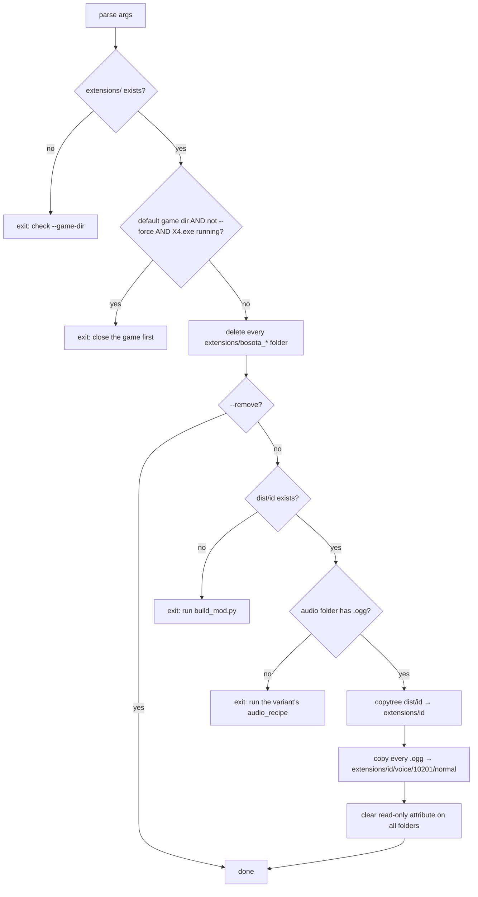

# 8 · Installing & Releasing (`tools/install_mod.py`, `release/`, Workshop, ModDB)

> **What you'll be able to answer after this chapter:** what the installer does step by step and which guards it has (flow, failure), why it refuses to run while X4 is open (rationale), how the Workshop and ModDB releases are produced and why Workshop needs its own variants (operations, rationale), and what the `release/` folder is.

## `install_mod.py`

### Contract

Two call forms (`tools/install_mod.py:76-84`):

- Install: `python -I tools/install_mod.py <variant key> [--game-dir <X4>] [--force]`
- Remove: `python -I tools/install_mod.py --remove [--game-dir <X4>] [--force]`. The variant key is optional here; `--remove` only deletes the installed `bosota_*` folders. The `extensions/` check and the running-game check still apply, the `dist` and audio checks and the copying do not.

`-I` starts Python in isolated mode: it ignores the `PYTHON*` environment variables and the user site-packages and keeps the script folder off `sys.path`; ordinary variables such as `X4_GAME_DIR` still work.

A variant, chosen by `<variant key>` (defined in `config/variants.json`, see [ch. 4](04-variants-configuration.md)), has an `<id>`, which is the mod folder name (for example `bosota_voice_will_de`, or `ws_<number>` for a Workshop item), and an `<audio_variant>`, the name of the folder under `build/audio/` that holds its `.ogg` files. `<line id>` is the numeric id of a voice line.

- **Pre:** when installing: `dist/<id>/` exists (built) and `build/audio/<audio_variant>/` contains `.ogg` files; always: `<game>/extensions/` exists, X4 is not running (only checked for the default game folder).
- **Post:** `<game>/extensions/<id>/` contains `content.xml`, `libraries/sound_library.xml` and `voice/10201/normal/<line id>.ogg` for every file in the audio folder; no other `bosota_*` folder remains.

### Mechanism

(`tools/install_mod.py:86-119`). E4 points at the variant's `audio_recipe` in `config/variants.json`: the commands that produce its audio folder with `process_audio.py` ([ch. 6](06-audio-processing.md)) or, for the Will variants, with text-to-speech first ([ch. 7](07-text-to-speech.md)).

- **Running-game guard** (`:50-58`, `:89-90`): `tasklist /FI "IMAGENAME eq X4.exe"` is searched as bytes because `tasklist` prints in the OEM code page (the console's character set, which is not the one Python decoded with) and decoding as cp1252 crashed. If `tasklist` is unavailable the check returns `False` and does not block. Reason: X4 reads the mod's diff (`libraries/sound_library.xml`, whose entries redirect the voice lines to the mod's `.ogg` files) at start-up; replacing the mod folder underneath a running game leaves the loaded redirect pointing at deleted files, and Boso, the voice replaced by this mod, goes silent with nothing in the log (it happened once).
- **Removal** (`:92-95`) uses `rmtree_retry` (`:61-73`): five attempts, 0.5 s apart, with an error handler that clears the read-only attribute and retries the failed call (`:34-41`). OneDrive marks folders read-only and `copytree` copies that attribute into the game folder; Windows refuses `rmdir` on such folders. After copying, `clear_readonly_tree` removes the attribute from every installed folder (`:44-47`, `:117`).
- **Audio** is always copied (`:105-116`). Up to 2026-10-24 the copy was conditional on a field `kind == "audio"` that a clean-up had removed from the configuration, so the installer reported success while installing no audio; fixed by making the copy unconditional and checking for audio **before** anything is copied.

### Gotchas

- **Removal happens before the `dist` and audio checks** (E3 and E4 in the flowchart). If either check fails (no `dist/<id>/`, or an empty audio folder), the previously installed variant is already gone when the installer stops (`:92-95` precede `:109-110`). The game then plays the originals.
- **`ws_*` folders are not removed.** `PREFIX = "bosota_"` (`:30`). A subscribed Workshop item, or a local install of a Workshop variant such as `alien_ws` (a `ws_*` variant, see [ch. 4](04-variants-configuration.md)), leaves an `extensions/ws_<n>/` folder in the game's `extensions/` that the installer neither deletes nor checks. A local `bosota_*` install then coexists with it and both patch the same entries. A staging run (installing a Workshop variant with `--game-dir build/workshop/stage2` for German or `build/workshop/stage2_en` for English instead of the game folder, to produce the upload copy; see "Steam Workshop") leaves its `ws_<n>` folder only there, where nothing else can coexist with it, but it blocks the next run (next point).
- **Installing over an existing folder crashes.** `shutil.copytree(src, dst)` (`:111`) has no `dirs_exist_ok`, so if `extensions/<id>/` already exists it raises `FileExistsError`. For `bosota_*` ids this cannot happen (they were just removed); for `ws_*` ids it does: every staging run after the first one, or a local `ws_*` install while the Workshop item is subscribed, fails, and by then the `bosota_*` folders are already gone. Delete `build/workshop/stage2/extensions/ws_<n>` (or the game's `extensions/ws_<n>`) by hand first.
- **The target `extensions/` folder must exist** (`:86-88`); for staging create `build/workshop/stage2/extensions/` and `build/workshop/stage2_en/extensions/` once.
- **It deletes any folder named `bosota_*`**, whoever made it (`:92-95`). That other mods are left untouched holds only by naming convention.
- `--force` skips only the running-game check; it does not make swapping safe.

## Steam Workshop

Two items exist, both created on 2026-10-22: **3824406333** (German, TTS voice "Will") and **3824446410** (English). The configuration holds version 102 for the German and 101 for the English item; the upload of 2026-10-24 by modpub (see "`release/` and modpub" below) pushed 103 and 102 respectively, with the titles modpub set, so the configuration is one version behind the Workshop on both items ([ch. 4](04-variants-configuration.md)). Uploads use Egosoft's `WorkshopTool.exe` from "X Tools" (`docs/RELEASE.md`).

Why separate Workshop variants: Steam installs an item under the folder name `ws_<number>`. On the author's machine the subscribed German item sits in the game's own folder, `C:\Steam\steamapps\common\X4 Foundations\extensions\ws_3824406333\`, packed as `content.xml` + `ext_01.cat` + `ext_01.dat` (observed 2026-10-24); `docs/RELEASE.md` names `Documents\Egosoft\X4\<user id>\extensions\` as the location, which did not hold here. Either way the redirect (the `sound_library.xml` entry that holds the path to the voice file) contains the folder name, so the uploaded build must have `id = ws_<number>`. Inside the item the files are packed in a catalog, not loose as in a local install; the engine resolves the same redirect path through the mounted catalog as it would for loose files. The number exists only after the first `publishx4`, which therefore uploads a placeholder; `update` then uploads the real build ([ch. 4](04-variants-configuration.md)).

Observed behaviour of the tool, as recorded in `docs/RELEASE.md` from the author's own uploads and not compared with the tool's built-in help (`docs/RELEASE.md` also has the call syntax; `publishx4` creates a new item, `update` uploads to an existing one; the Steam error numbers 16 and 9 are identifiers only, their meaning is not recorded):

- Only files of the types `.cat/.dat/.cur/.mkv/.txt/.pdf` are uploaded, subfolders and their contents are not; `-buildcat` packs everything into `ext_01.cat/.dat`. How `content.xml` itself gets into the item is not recorded here (not verified).
- Creating an item together with 56 MB of audio timed out twice (Steam error 16); creating it with XML only and adding the audio with `update` worked.
- The first `update` of a fresh item failed with error 9 while `-preview` was passed and succeeded without it.
- `update` needs a higher `version` in `content.xml` or `-minor`, and `-changenote`. `-namedesc up` also pushes title and description from `content.xml`, which would overwrite the titles modpub set.
- `publishx4` writes the new `ws_` id back into the uploaded folder's `content.xml` (`docs/RELEASE.md`); an unverified note says the tool's documentation also mentions a `sync="false"` attribute; its location and effect are not recorded in the repository. This rewriting is why uploads happen from staging copies, never from `dist/` or the game folder. There are two staging levels: the installer writes the Workshop builds into `build/workshop/stage2/` (DE) and `build/workshop/stage2_en/` (EN), which a manual upload uses directly; modpub reads the same folders (`release/mod.yaml:41-43`) and uploads its own copies from `release/out/workshop/<lang>/`.

## ModDB and other channels

ModDB receives ZIPs whose top-level folder is the mod folder (`bosota_voice_will_de`, `bosota_voice_alien_en`), so users extract them straight into `extensions\`. Package contents, description and checklist: `docs/RELEASE.md`, `docs/release/MODDB_DESCRIPTION.md`.

### `release/` and modpub

`release/mod.yaml` describes the release for **modpub**, a separate tool in `C:\#repos\github\modpub` that renders comparison videos and thumbnails, writes channel texts and uploads to YouTube, the Workshop, Reddit and ModDB (`docs/RELEASE.md`, section "modpub"). The manifest lists both languages, two comparison lines (`30201131`, `30201057`) with subtitles, the Workshop item numbers and staging paths (`release/mod.yaml:39-43`) and the ModDB ZIP paths. `release/out/text/*.md` holds the channel texts; `release/out/workshop/<lang>/` holds modpub's upload copies (full mod including audio, ignored by git); `release/out/status.json` records what was published, including the YouTube video ids `v4PVMONMwl0` (EN) and `YyyKmJ3aTdc` (DE) (`release/out/status.json:25-34`). Committed are only `release/mod.yaml`, `release/out/text/` and `release/out/status.json`; `release/assets/` (copies of game audio) and everything else under `release/out/`, including `workshop/`, are ignored (`.gitignore:10-13`). This book does not cover modpub's internals.

## Legal and "modified"

Any unsigned extension marks the game as modified, and the flag stays on every save made with it, even after the mod is removed. A modified game cannot use the online Ventures, which Egosoft has switched off anyway. According to several player reports, Steam achievements still unlock with mods; no Egosoft statement was found and this project has not tested it. `README.md` was corrected on 2026-10-25; `docs/HOW-IT-WORKS.md`, `docs/release/MODDB_DESCRIPTION.md` and the release texts still claim lost achievements. The English variant contains processed Egosoft recordings; the German variant contains TTS generated on a paid ElevenLabs plan from Egosoft's texts. Free distribution as a mod is, in the author's assessment, the common, tolerated practice; selling it is not possible without Egosoft. Details: `docs/RELEASE.md`, `docs/HOW-IT-WORKS.md`.

## Where to look

`tools/install_mod.py`, `docs/RELEASE.md`, `release/mod.yaml`, `config/variants.json` (Workshop variants).

→ Check your understanding: [quizzes/08-installing-and-releasing-quiz.md](quizzes/08-installing-and-releasing-quiz.md)
