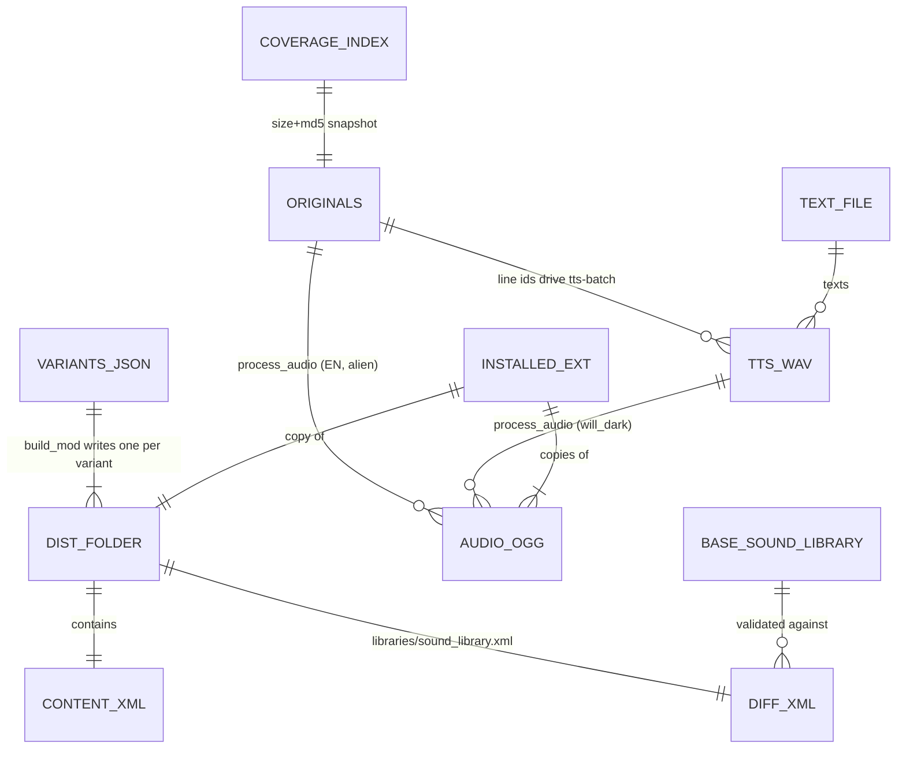

# 10 · Data Model & Files

> **What you'll be able to answer after this chapter:** every file and folder the system reads or writes, who writes and who reads each one, their formats and lifecycles (state & data), and which are versioned.

There is no database. All state is files. This chapter is the ledger.

## Entities



## Ledger

| Path | Format | Written by | Read by | Versioned | Lifecycle |
|---|---|---|---|---|---|
| `config/variants.json` | JSON ([ch. 4](04-variants-configuration.md)) | humans | `build_mod.py`, `install_mod.py` | yes | edited when a variant changes |
| `dist/<id>/content.xml` | Egosoft content XML | `build_mod.py` | `validate_mod.py`, `install_mod.py`, X4 | yes | regenerated on every build (date changes) |
| `dist/<id>/libraries/sound_library.xml` | `<diff>` | `build_mod.py` | `validate_mod.py`, `install_mod.py`, X4 | yes | regenerated |
| `build/orig/voice-l0XX/10201/normal/*.ogg` (path chosen by the user) | Ogg Vorbis mono 44.1 kHz | `x4cat_extract.py` | `process_audio.py`, `tts-batch --ids-from` | no | re-extract after patches |
| `build/base/t/0001-l044.xml`, `0001-l049.xml` | X4 text XML | `x4cat_extract.py` (by hand) | `tts-batch`, `check_coverage.py --tfile` | no | refresh after patches |
| `build/base/libraries/sound_library.xml` | X4 sound library | `validate_mod.py` (every run) | `validate_mod.py` | no | overwritten on each run |
| `build/tts/will_de/*.wav` | WAV mono 44.1 kHz | `tts-batch` | `process_audio.py --src-ext wav` | no | kept; acts as the resume cache |
| `build/audio/<audio_variant>/*.ogg` | Ogg Vorbis mono 44.1 kHz, normalised | `process_audio.py` (+ 5 copied fallbacks for `will_dark_g6`) | `install_mod.py`, `check_coverage.py` | no | one folder per chain+gain |
| `build/index/10201_<lang>.json` | JSON `{id: [size, md5]}` | `check_coverage.py --save-index` | `check_coverage.py` | no | snapshot per patch |
| `build/workshop/stage*/extensions/<id>/` | installed-layout copy | `install_mod.py --game-dir …` | `WorkshopTool`, modpub | no | `content.xml` is rewritten by WorkshopTool |
| `build/moddb_package/` | ZIPs, images, texts | by hand / modpub | ModDB upload | no | per release |
| `build/venv/` | Python venv with `requests` | by hand | `voice_convert_elevenlabs.py` | no | survived the move out of OneDrive; use `python.exe -m pip`, the `pip.exe` launcher keeps the old path |
| `release/mod.yaml` | YAML | humans | modpub | yes | per release |
| `release/out/text/*.md`, `release/out/status.json` | Markdown, JSON | modpub / humans | humans | yes | per release |
| `release/assets/` | images, audio copies | modpub | modpub | no | |
| `release/out/workshop/<lang>/` | full mod copy incl. audio, `content.xml` with modpub's version/title | modpub | WorkshopTool (via modpub) | no | per Workshop upload; holds the **live** version numbers |
| `<game>/extensions/<id>/` | installed extension | `install_mod.py` | X4 | — | replaced on each install |
| `%USERPROFILE%\.elevenlabs_key` | one line of text | the user | `voice_convert_elevenlabs.py` | never | rotate if exposed |

### Audio folder naming

`<chain>_g<gain>`: `d12_alien_mid_g9` = chain `d12_alien_mid` with `--gain-db 9`. The name is a convention, not parsed by code; what links a variant to its folder is `audio_variant`.

### The installed layout

```text
<game>\extensions\bosota_voice_will_de\
├── content.xml
├── libraries\sound_library.xml          ← the diff
└── voice\10201\normal\
    ├── 1000001.ogg
    ├── …                                ← 2,324 files, names = line ids
    └── 30253538.ogg
```

The folder name, the `id` in `content.xml` and the second segment of the redirect path are the same string. That equality is the system's central invariant.

A **subscribed Workshop item** has a different physical layout but the same logical one: `extensions\ws_3824406333\` contains `content.xml`, `ext_01.cat` and `ext_01.dat`; `libraries/…` and `voice/10201/normal/…` are entries inside the catalog, which X4 mounts relative to the extension folder.

## Invariants

1. Folder name = `content.xml id` = redirect segment.
2. Every line id the game has for the installed language exists in `voice/10201/normal/`.
3. Exactly one variant is installed.
4. The audio folder of a variant matches its language (an English install with German files plays German lines).

## Where to look

`.gitignore`, `tools/build_mod.py`, `tools/install_mod.py`, `tools/check_coverage.py`.

→ Check your understanding: [quizzes/10-data-model-quiz.md](quizzes/10-data-model-quiz.md)
