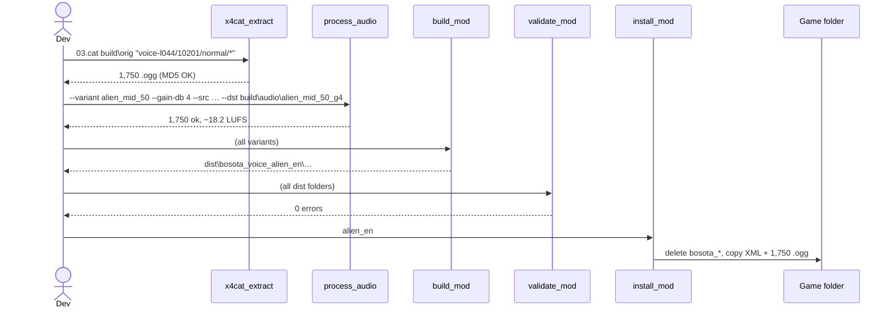
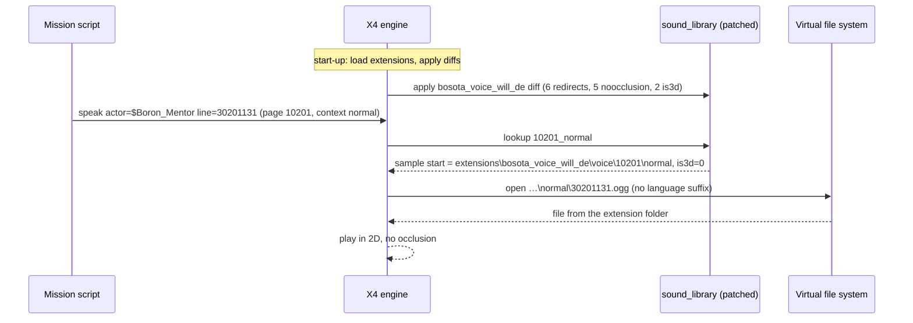

# 11 · Key Flows

> **What you'll be able to answer after this chapter:** the exact end-to-end path for building each published variant, for an in-game playback, for a Workshop release and for a post-patch repair, with real commands and values (control & data flow).

## Flow A: build and install the English variant

1. Extract the English originals: `x4cat_extract.py "<game>\03.cat" build\orig "voice-l044/10201/normal/*"` (in 9.00 all of page 10201, both languages, is in `03.cat`).
2. `process_audio.py --variant alien_mid_50 --gain-db 4` → `build/audio/alien_mid_50_g4/`, each file: Rubberband −6 semitones (factor 0.7071), frequency shift −35 Hz, chorus at half depth, mid-range focus, loudness to −22 LUFS linear, +4 dB, limiter −1 dBFS. Measured result for line 30201131: −18.2 LUFS, peak −1.5 dBTP.
3. `build_mod.py` → `dist/bosota_voice_alien_en/` with the redirect to `extensions\bosota_voice_alien_en\voice\10201\normal`.
4. `validate_mod.py` → 0 errors.
5. Close X4, `install_mod.py alien_en`.
6. Test with the launch option `-voicelanguage 44` (English speech, interface unchanged).

## Flow B: build the German Will variant

1. Extract the German originals (for the line ids) and the text file (for the texts):
   `x4cat_extract.py "<game>\03.cat" build\orig "voice-l049/10201/normal/*"` and `x4cat_extract.py "<game>\09.cat" build\base "t/0001-l049.xml"` → `build/base/t/0001-l049.xml`.
2. `tts-batch --voice bIHbv24MWmeRgasZH58o --model eleven_v4_turbo --tfile build/base/t/0001-l049.xml --ids-from build\orig\voice-l049\10201\normal --dst build/tts/will_de` → 2,319 WAVs; 5 ids without text.
3. `process_audio.py --variant will_dark --src build/tts/will_de --src-ext wav --gain-db 6 --dst build/audio/will_dark_g6` → 2,319 `.ogg`, −16.0 LUFS.
4. Copy the 5 textless ids from `build/audio/d12_alien_mid_g9/` → 2,324 files. On a fresh clone render them first: `process_audio.py --variant d12_alien_mid --gain-db 9 --files 10417,10603,30226001,30226002,30226003 --src build\orig\voice-l049\10201\normal --dst build\audio\d12_alien_mid_g9`.
5. `check_coverage.py --lang l049 --audio build/audio/will_dark_g6` → 0 missing.
6. `build_mod.py`, `validate_mod.py`, `install_mod.py will`.

## Flow C: what happens in the game

Without the mod, the engine would turn `voice\10201\normal` into `voice-l049\10201\normal\30201131.ogg` by inserting the language suffix. The literal handling of the redirected path was proven by a diagnostic that pointed the flight-school tutor at a folder named `voice` containing Betty's lines and a folder `voice-l049` containing Boso's: the tutor spoke with Betty's voice (`docs/HISTORY.md`).

## Flow D: Workshop release of a new build

1. Delete the previous staging copy `build/workshop/stage2/extensions/ws_3824406333/` (the installer only cleans `bosota_*` and `copytree` refuses an existing target), make sure `build/workshop/stage2/extensions/` exists, then `install_mod.py alien_ws --game-dir build/workshop/stage2` → fresh staging copy with audio.
2. Raise `version` of `alien_ws` above the **live** version (103 after the modpub upload, see [ch. 4](04-variants-configuration.md)), `build_mod.py`, then step 1.
3. From the X Tools folder: `WorkshopTool.exe update -path "<…>\stage2\extensions\ws_3824406333" -buildcat -changenote "…"`.
4. Subscribers receive the update automatically. The external modpub tool can run steps 1–3 from `release/mod.yaml` ([ch. 8](08-installing-and-releasing.md)).

## Flow E: after an X4 patch

Find the catalogs → re-extract originals **and** texts → `validate_mod.py` → `check_coverage.py` for both languages → regenerate only missing ids → rebuild → Workshop `update` → note in `docs/HISTORY.md` → `--save-index` ([ch. 9](09-patch-maintenance.md)).

→ Check your understanding: [quizzes/11-key-flows-quiz.md](quizzes/11-key-flows-quiz.md)
